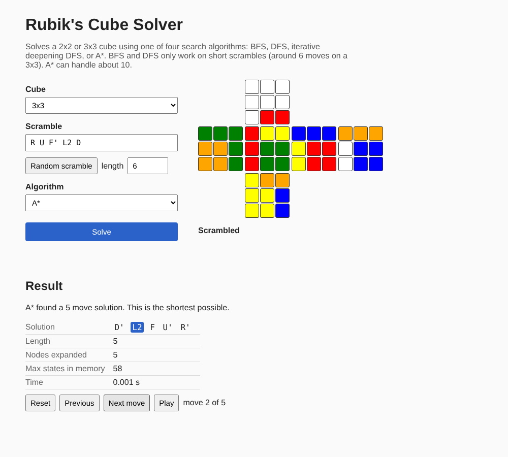

# Rubik's Cube Solver

A Rubik's cube solver for 2x2 and 3x3 cubes that uses search algorithms from my algorithms course: **BFS, DFS, iterative deepening DFS and A\***. I wanted to see how they actually compare on a real problem, so it also counts how many states each one explores and how much memory it uses.

It has a small web page where you type in a scramble, pick an algorithm, and step through the solution on an unfolded cube.



## Running it

You need Python 3.10 or newer.

```bash
python3 -m venv .venv
source .venv/bin/activate        # on Windows: .venv\Scripts\activate
pip install -r requirements-dev.txt
python -m cubesolver
```

Then open http://localhost:8001. The first time, it takes about 10 seconds to build the lookup tables A* uses. They get saved, so after that it starts right away.

You can also use it from the terminal:

```bash
python -m cubesolver solve "R U R' U' F2 D"             # uses A*
python -m cubesolver solve "R U F' L2" --algo bfs
python -m cubesolver solve random --size 2              # random 2x2
python -m cubesolver race "R U F' L2 D B'"              # runs all 4 and compares them
```

Moves use standard notation: `U R F D L B` turn a face clockwise, `'` means counter-clockwise, and `2` means a half turn.

## The algorithms

- **BFS** tries every position 1 move away, then every position 2 moves away, and so on. It always finds the shortest solution, but it has to remember every position it has seen.
- **DFS** goes as deep as it can down one path, then backtracks. It uses almost no memory, but the first solution it finds usually isn't the shortest. It needs a depth limit, so I set it to the scramble length, since undoing the scramble always works.
- **Iterative deepening DFS** runs DFS with a depth limit of 1, then 2, then 3, and so on. It finds the shortest solution like BFS with DFS's memory usage, but it repeats a lot of work.
- **A\*** always explores the position with the lowest (moves so far + estimated moves left). If the estimate never overestimates, the answer is still the shortest.

## What I found

I ran each algorithm on random scrambles with a 10 second limit. Each cell shows the median states explored and the median time. ✗ means it gave up on every scramble, and (1/3) means it only solved one out of three.

**3x3**

| Algorithm | 4 moves | 5 moves | 6 moves | 7 moves | 8 moves | 9 moves |
|---|---|---|---|---|---|---|
| BFS | 2.3k, 0.04s | 17.5k, 0.38s | 86k, 2.2s (1/3) | ✗ | ✗ | ✗ |
| DFS | 2.2k, 0.02s | 15.1k, 0.22s | 139k, 2.0s | 626k, 9.0s (1/3) | ✗ | ✗ |
| Iterative deepening | 2.5k, 0.07s | 18.9k, 1.4s | 190k, 3.7s | ✗ | ✗ | ✗ |
| A* | 39, <0.01s | 11, <0.01s | 16, <0.01s | 37, <0.01s | 147, 0.01s | 1.4k, 0.16s |

**2x2** (9 fully random scrambles each)

| Algorithm | Solved | Median solution | Median states explored | Max states in memory |
|---|---|---|---|---|
| BFS | 6/9 | 8 moves | 163k | 1.5M (hit the limit) |
| DFS | 6/9 | 11 moves | 1.4M | 10 |
| Iterative deepening | 9/9 | 9 moves | 764k | 8 |
| A* | 9/9 | 9 moves | 3k | 25k |

Some things I noticed:
- Every extra move multiplies the work by about 13, because that's roughly how many moves you can make from each position. That's why BFS, DFS and iterative deepening all hit a wall around 6 or 7 moves on a 3x3.
- BFS runs out of **memory**, while iterative deepening runs out of **time**. Both find the shortest solution, but iterative deepening only ever stores the current path.
- DFS gave 11-move solutions on the 2x2 when 9 was possible. It just takes the first one it finds.
- A* is way faster because of its estimate, but it still stores every state it generates. On a 3x3 it can do 10 moves in about 4 seconds, but at 11 moves it runs out of memory too.
- A fully scrambled 3x3 needs around 18 to 20 moves, so none of these four can solve one. Real solvers use smarter algorithms for that, like IDA* or Kociemba's algorithm.

## How it works

**The cube.** `geometry.py` builds the cube out of stickers in 3D space and makes each move an actual 90-degree rotation of one layer. I did it this way because typing the moves in by hand is easy to get wrong. The search code uses a faster version (`cubie.py`) that tracks where each corner and edge piece is, and its moves are generated from the 3D version.

**The search.** All four algorithms are in `search.py`. They work on any puzzle that gives them a start state, a goal state, and a way to get the next states, so the 2x2 and 3x3 share the same code. I added two tricks that help all of them:
- Never turn the same face twice in a row, since `R R` is the same as `R2`.
- Only allow one order for opposite faces, since `U D` and `D U` end up in the same place.

**A\*'s estimate.** A* needs a guess of how many moves are left that's never too high. I precompute tables with BFS that store how many moves it takes to fix just one part of the cube, like only the corner orientations (`tables.py`). Fixing part of the cube can't take more moves than fixing all of it, so it never overestimates. I take the max of a few of these tables.

**The 2x2 trick.** A 2x2 has no centers, so turning the bottom layer is the same as turning the top and rotating the whole cube. That means I can keep one corner fixed and only use 3 faces, which cuts the number of positions to 3,674,160. As a check, one of my tests runs BFS over all of them and compares the counts to the published numbers. They match exactly.

## Tests

```bash
pytest
```

There are 33 tests. They check that:
- The moves are correct, e.g. doing `R U R' U'` six times brings the cube back to solved.
- The estimate never overestimates.
- BFS, iterative deepening and A* always find the same length solution.
- Every solution actually solves the scramble.

## Things I'd add next

- IDA*, so A* doesn't run out of memory
- Bidirectional BFS (searching from both ends and meeting in the middle)
- Entering a real cube's colours instead of typing a scramble
